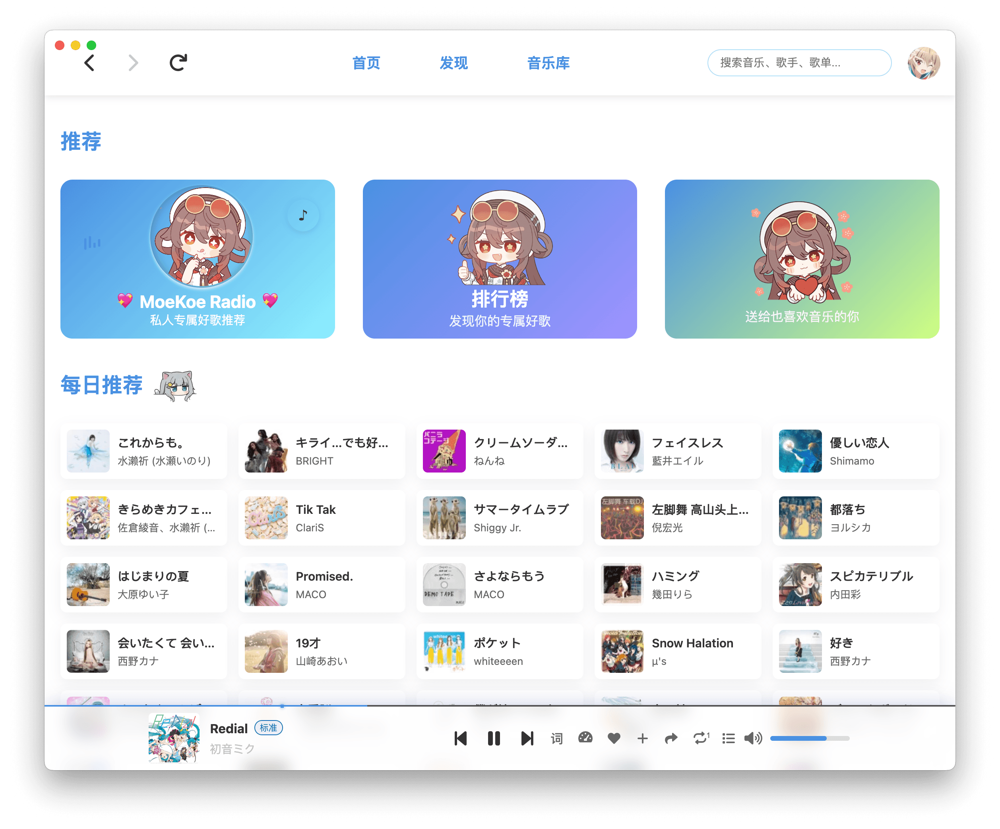
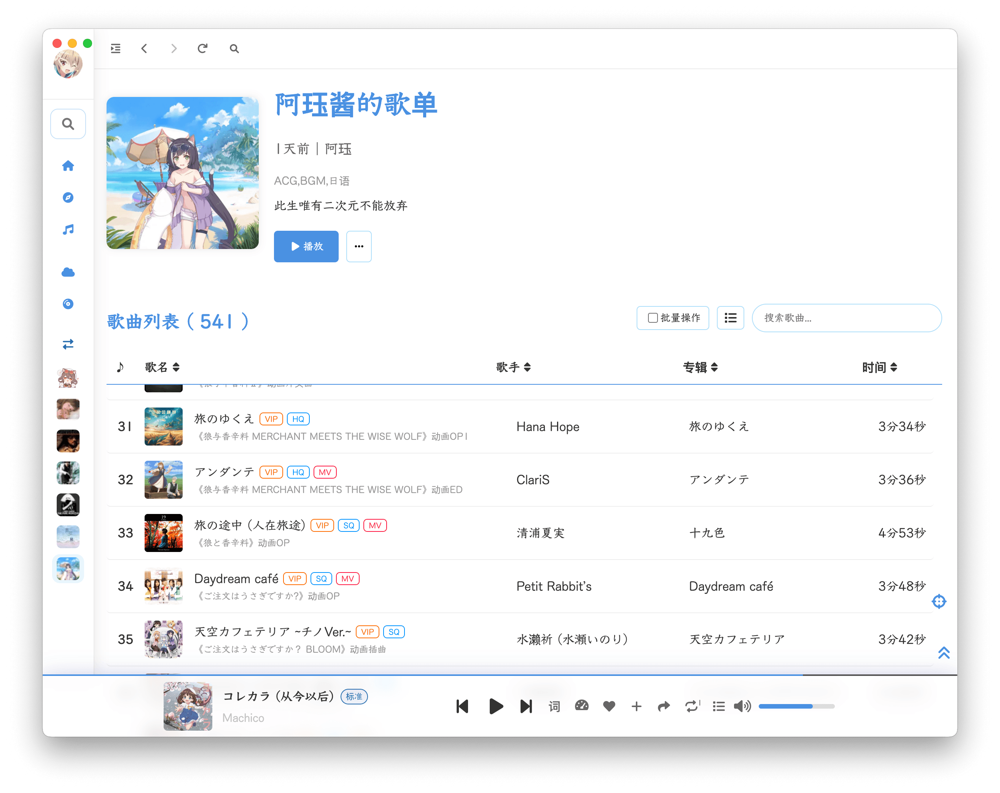
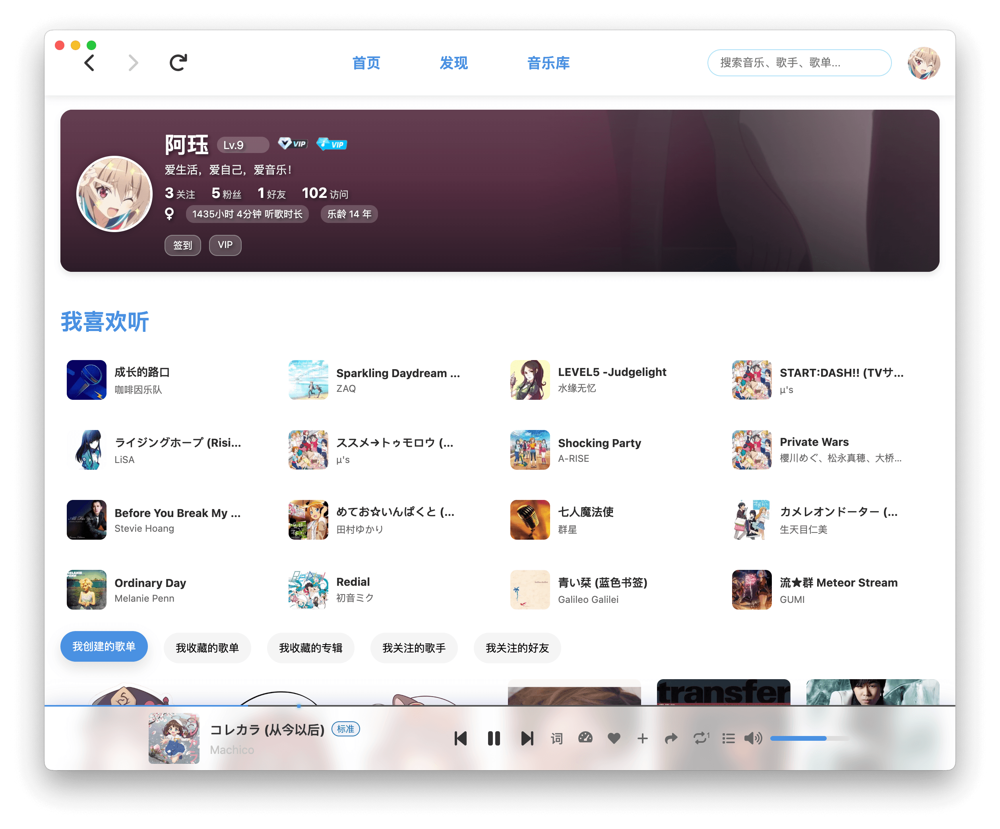
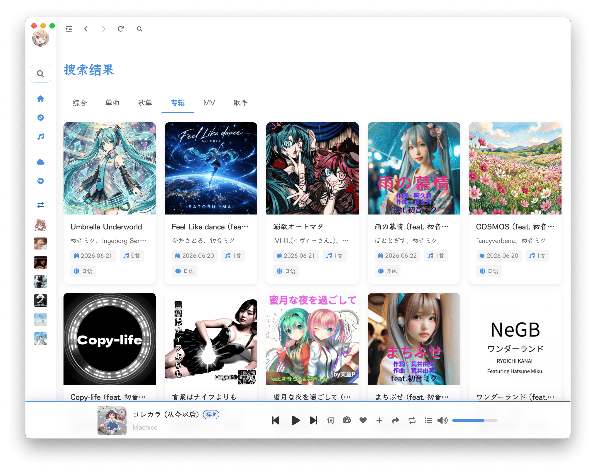
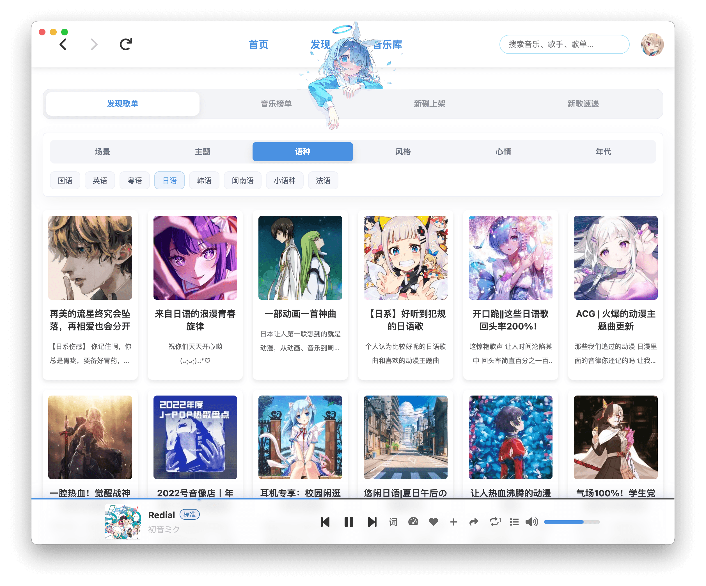
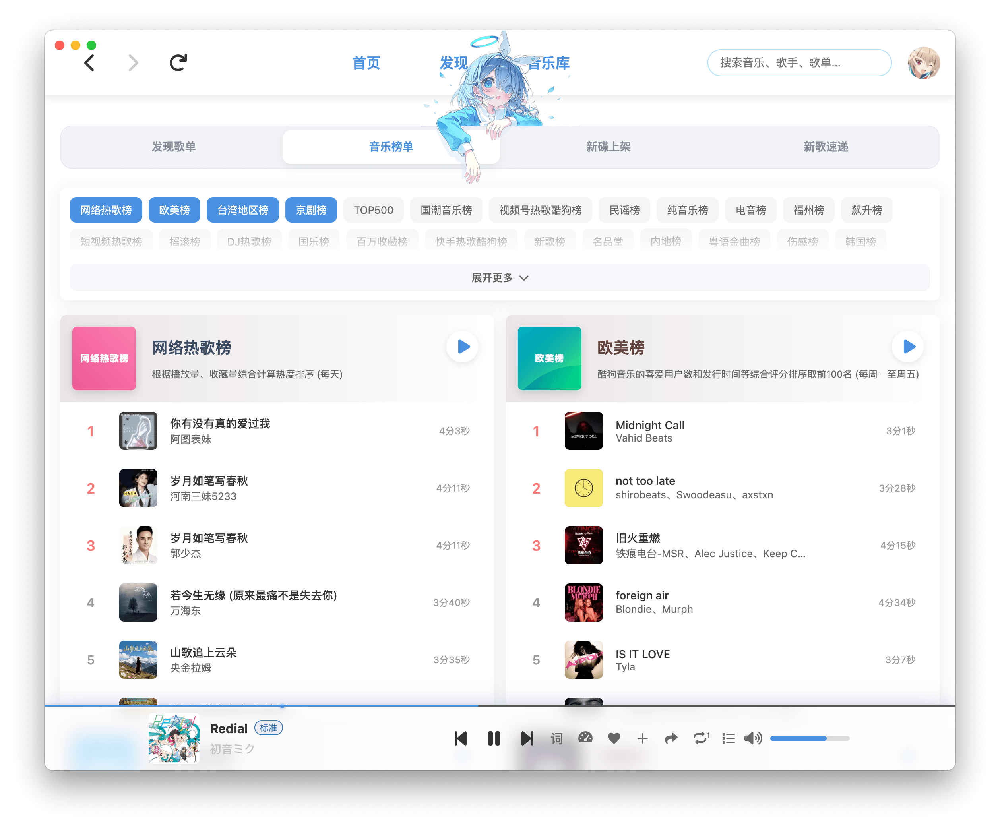
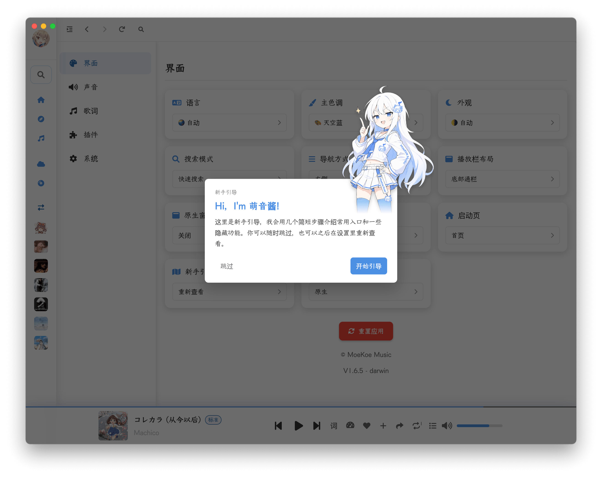
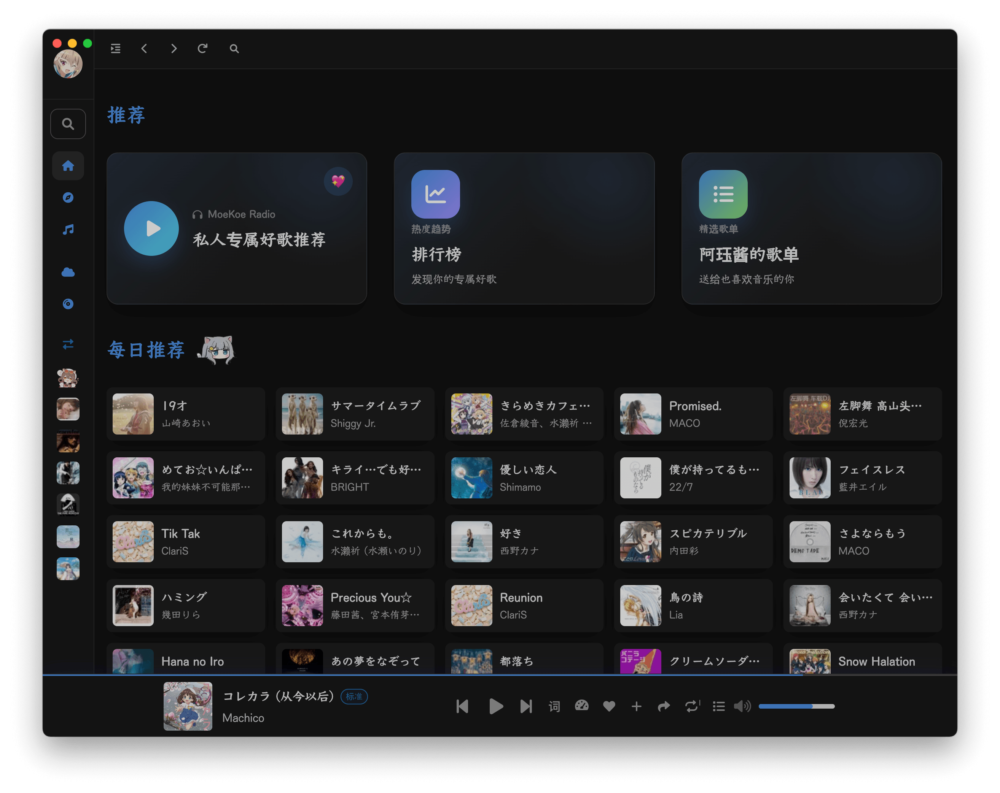
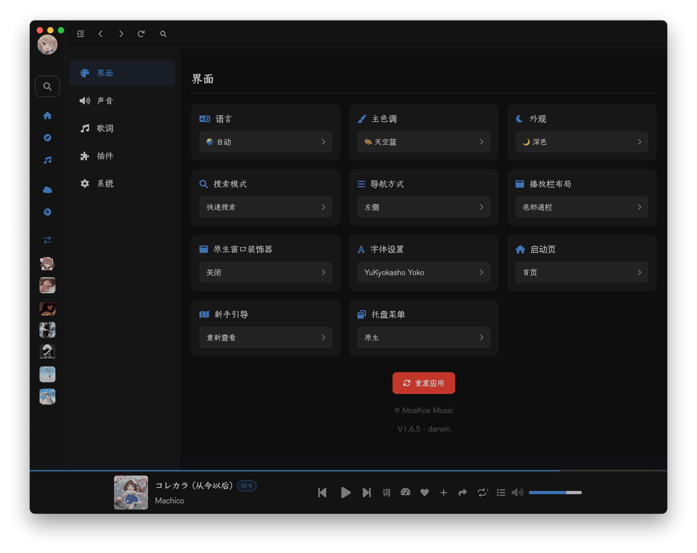
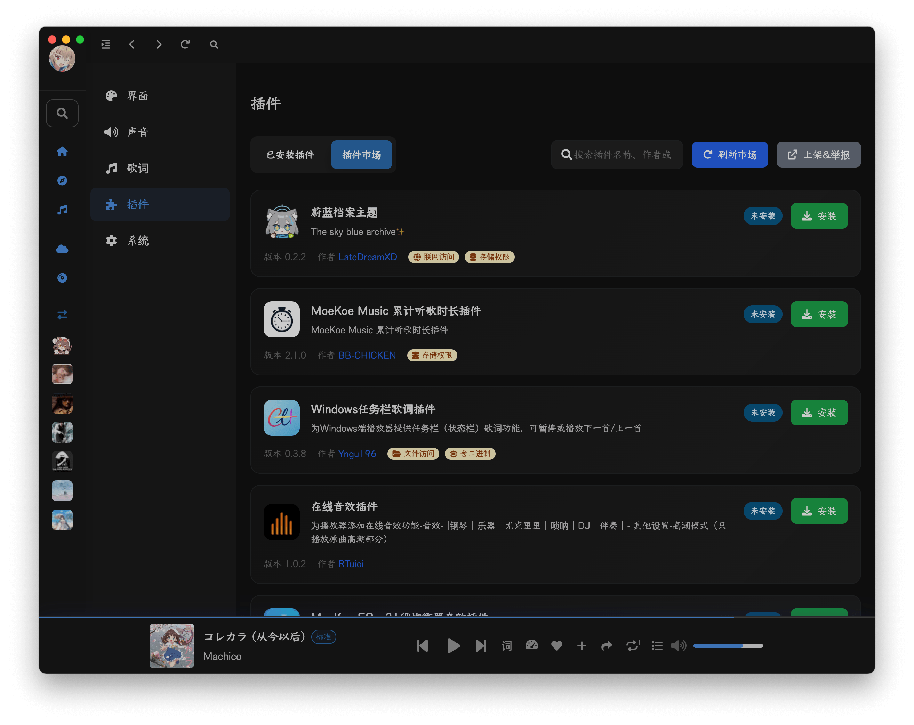

<p align="center">
  
  <h2 align="center">KGmusic</h2>
  <p align="center">自托管的酷狗第三方音乐播放器 —— Rust 后端 + Vue 前端</p>
</p>

## 这是什么

KGmusic 由**两个相互独立的程序**组成：

| 目录 | 是什么 | 技术栈 |
| --- | --- | --- |
| `server/` | 酷狗 API 服务端，同时托管前端静态文件 | Rust（crate `kgmusic`，可执行文件 `kgmusic-server`） |
| `web/` | 网页播放器 | Vue 3 + Vite |

最终产物是**一个可执行文件**：同一个进程既在 `/api` 前缀下提供酷狗 API，也把 `web/dist`
里的页面发出去。**运行时不需要 Node，也不需要 nginx。**

两者只通过 HTTP 通信，各自适用不同的许可证，详见 [LICENSING.md](LICENSING.md)。

## 特性

- 🔴 酷狗账号登录：扫码 / 手机号 + 验证码
- 🏠 首页、发现、音乐库
- 🔍 搜索：综合搜索、搜索建议、热门搜索、推荐搜索
- 📃 歌单：详情、收藏与取消收藏、标签
- 🏆 排行榜
- 📻 每日推荐；每日自动领取 VIP（登录即 VIP）
- ☁️ 音乐云盘：上传、获取播放地址、删除
- 💾 本地音乐：浏览器本地文件解析与播放
- 🎤 听歌识曲
- 📺 MV 播放
- 🎼 歌词显示
- 🤝 组队领 VIP 活动
- 🎨 主题色切换、Light / Dark
- 🌐 6 种界面语言：简中、繁中、英、日、韩、俄
- 📱 PWA：可安装、可离线打开

## 前置要求

| 用途 | 需要 |
| --- | --- |
| 运行 / 部署 | Rust 工具链，`cargo >= 1.85` |
| 只修改前端时需要 | Node.js >= 20 |

服务本身**不需要 Node**——`web/dist` 已随仓库提供。

## 📁 项目结构

```
KGmusic/
├── server/           # Rust 后端：酷狗 API + 静态文件托管
│   │                 #   crate `kgmusic`，可执行文件 `kgmusic-server`
│   ├── src/modules/  # 每个文件对应上游 KuGouMusicApi 的一个 module/*.js
│   ├── tests/        # 单元与冒烟测试
│   └── vendor/       # tiny_http 的本地补丁版
├── web/              # 前端：Vue 3 + Vite（MoeKoe 萌音的 web 版）
│   ├── src/          # 前端源码
│   ├── public/       # 静态资源
│   └── dist/         # 前端构建产物（随仓库提供，后端直接托管）
├── data/             # 运行时数据：device_info.json（设备指纹）
├── images/           # 截图
├── LICENSING.md      # 许可说明：两个程序为何必须分别授权
└── README.md
```

## 🚀 快速开始

**运行时只需要 Rust 工具链**（cargo >= 1.85）。前端构建产物 `web/dist/` 已随仓库提供，开箱即用。

```sh
git clone https://github.com/calculus07/KGmusic.git   # 或 git@github.com:calculus07/KGmusic.git（需配置 SSH 密钥）
cd KGmusic
cargo run --release --manifest-path server/Cargo.toml
```

在 KGmusic 根目录执行时，默认参数正好匹配仓库布局（`--static-dir web/dist`、`--data-dir ./data`），
所以不需要附加参数。启动后访问 <http://127.0.0.1:6521/> 。

先编译再运行也可以：

```sh
cargo build --release --manifest-path server/Cargo.toml
./server/target/release/kgmusic-server                       # 仅本机访问
./server/target/release/kgmusic-server --host 0.0.0.0        # 对外提供服务
```

## ⚙️ 开发

> 只有**修改前端**时才需要 Node.js（>= 20）。运行后端不需要它。

1. 安装前端依赖

```sh
cd KGmusic/web
npm install
```

2. 启动开发者模式（开两个终端）

```sh
# 终端 A：在 KGmusic 根目录启动 Rust 后端，监听 6521
cargo run --release --manifest-path server/Cargo.toml

# 终端 B：在 web/ 目录启动 Vite 开发服务器，监听 8080
cd web && npm run serve
```

Vite 开发服务器不设 `VITE_APP_API_URL`，前端会直连 `http://127.0.0.1:6521`；
后端已内置 CORS，不需要额外配置。

3. 重新构建前端产物（在 `web/` 下执行）

```sh
npm run build:web     # 产出 web/dist/（API 基址固化为 /api，供后端同源托管）
```

`web/dist/` 是随仓库提交的产物；改过 `web/src/` 之后必须重新构建，否则后端托管的还是旧版本。
如果前端要与后端分开部署，用 `npm run build`（不设 `VITE_APP_API_URL`），
再通过环境变量指定后端地址。

更多命令请查看 `web/package.json` 的 `scripts`。

## 👷‍♂️ 编译后端

后端是独立的 Rust 项目，位于 `server/`（crate 名 `kgmusic`），运行时不需要 Node。

```sh
cargo build --release --manifest-path server/Cargo.toml
```

产物：`server/target/release/kgmusic-server`（单个可执行文件）。

可用参数（同名环境变量写在括号里，命令行优先）：

| 参数 | 环境变量 | 默认值 | 说明 |
| --- | --- | --- | --- |
| `--host` | `HOST` | `0.0.0.0` | 监听地址 |
| `--port` | `PORT` | `6521` | 监听端口，`0` 表示随机端口 |
| `--data-dir` | `DATA_DIR` | `./data` | 设备指纹持久化目录 |
| `--static-dir` | `STATIC_DIR` | `web/dist` | 前端构建产物目录，不存在则只提供 API |
| `--api-prefix` | `API_PREFIX` | `/api` | API 挂载前缀，传空串则挂在根路径 |

`kgmusic-server --help` 可以查看完整说明。

### 后端结构

- `server/src/modules/` 下每个文件对应上游 KuGouMusicApi 的一个 `module/*.js`，
  行为逐一对齐；路由表在 `server/src/modules/mod.rs`。
- `/sidedt` 与 `/team/*`（组队领 VIP）是上游有、md3Music 未实现的部分，已用 Rust 补齐。
- 静态文件托管与 `/api` 前缀剥离在 `server/src/server.rs`，因此前端和 API 可以共用一个端口。

## ⚠️ 部署前必读

**1. 不要删除 `data/` 目录。** 里面是 `device_info.json`（设备指纹）。它只在首次启动时
向酷狗注册一次，之后本地复用；换一份新指纹会被上游当成新设备，可能触发风控。

**2. AGPL-3.0 要求你提供源码。** `server/` 采用 AGPL-3.0，把它作为网络服务对外提供时，
**必须向使用者提供对应源码**（AGPL 第 13 条）。上线时请在页面显眼处（页脚、「关于」页等）
附上你所部署版本的源码链接。

## 🖼️ 截图












## ⚠️ 免责声明

1. 本项目是酷狗音乐的**第三方非官方**客户端，与酷狗音乐及其母公司无任何关联，也未获其授权或认可。
   需要更完善的功能请使用官方客户端。
2. 本项目仅供**学习与技术研究**使用。请尊重版权、支持正版，请勿用于商业或非法用途。
3. 所有播放链接、歌词、封面、歌单等数据均通过公开接口**实时获取**，本项目不存储、不传播任何音频文件，
   版权归原平台及版权方所有。
4. 请在 24 小时内清除使用过程中产生的版权数据。禁止在违反当地法律法规的情况下使用本项目。
5. 因使用或无法使用本项目而产生的任何直接、间接、特殊、偶然或结果性损害，由使用者自行承担。
6. 如官方音乐平台认为本项目不妥，可联系本项目以更改或移除。

## 📜 开源许可

本仓库由**两个相互独立的程序**聚合而成，**分别适用不同的许可证**，不存在覆盖全仓库的单一许可证。
完整说明见 [LICENSING.md](LICENSING.md)。

| 目录 | 内容 | 许可证 | 全文 |
| --- | --- | --- | --- |
| `server/` | 酷狗 API 服务端（Rust） | **AGPL-3.0** | [server/LICENSE](server/LICENSE) |
| `web/` | 前端（Vue 3 + Vite） | **GPL-2.0-only** | [web/LICENSE](web/LICENSE) |

## 🙏 致谢

本项目站在以下项目的肩膀上：

| 项目 | 许可证 | 在本仓库中的角色 |
| --- | --- | --- |
| [md3Music](https://github.com/zzyoxml/md3Music) | AGPL-3.0 | `server/` 的 Rust 实现移植自其 `kugou_api_server` |
| [MoeKoeMusic](https://github.com/iAJue/MoeKoeMusic) | GPL-2.0-only | `web/` 前端（MoeKoe 萌音） |
| [KuGouMusicApi](https://github.com/MakcRe/KuGouMusicApi) | MIT | `server/` 接口行为的对照实现 |

界面设计灵感：[Apple Music](https://music.apple.com)、[YouTube Music](https://music.youtube.com)、
[YesPlayMusic](https://github.com/qier222/YesPlayMusic)。
